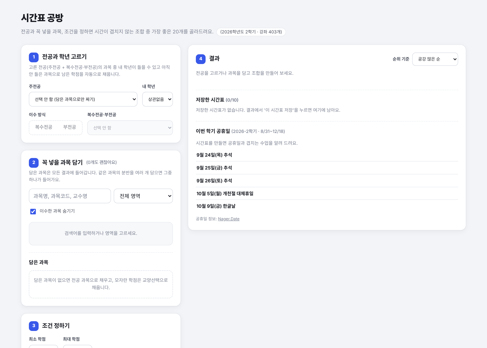
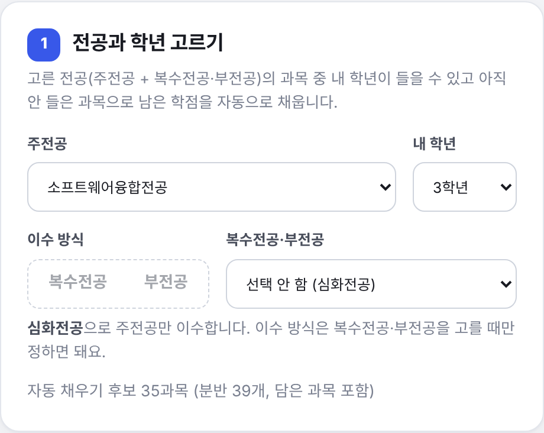
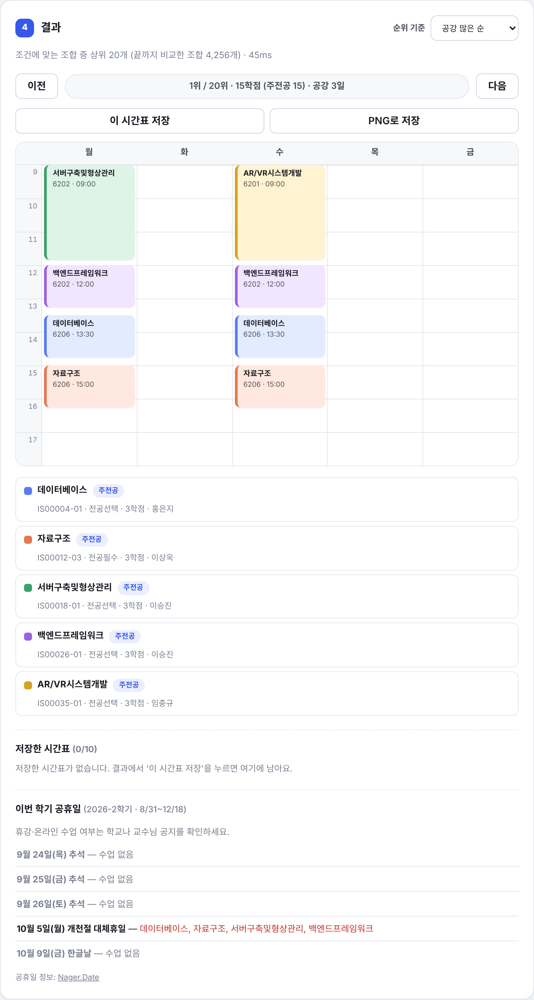
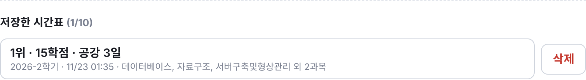
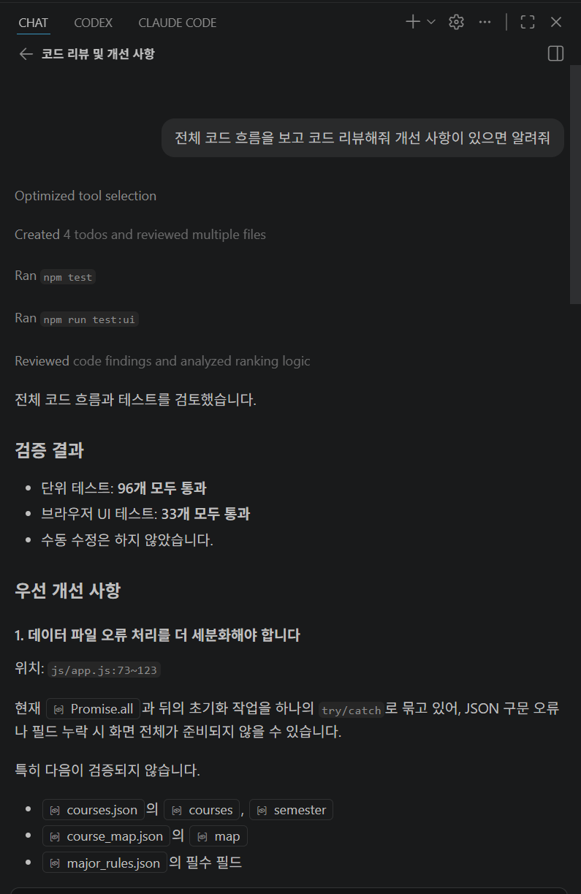
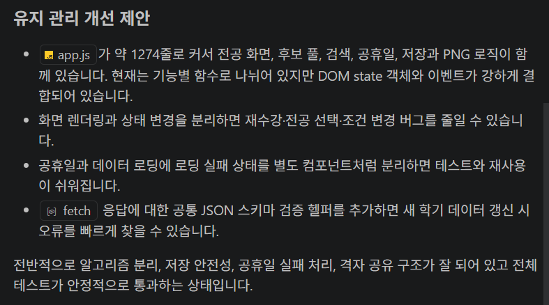

# 시간표 공방

주전공(+ 복수전공·부전공)과 꼭 넣을 과목, 학점·공강 조건을 정하면, 학교 전공 규칙에 맞고 이미 들은 과목을 뺀 시간표 조합을 **백트래킹**으로 찾아 **점수가 높은 상위 20개**를 보여 주는 웹 페이지입니다.
서버와 프레임워크 없이 HTML/CSS/JavaScript만으로 동작하고, GitHub Pages로 배포합니다.

- 대상: 성공회대학교 재학생, 2026학년도 2학기 개설강좌 403개
- 과목: VSCode + GitHub Copilot 활용 실무 프로그래밍 입문 (초급 트랙) 캡스톤 프로젝트
- 만든 사람: 박성준 (202214089)

> **커밋 기록 안내**
> 이 저장소의 커밋은 2026-11-18부터 시작합니다.
> 중간고사 계획서를 쓴 7주차부터 11월 중순까지는 Git 저장소 없이 로컬 폴더에서 개발하고, 버전은 날짜별 zip으로 보관했습니다.
> 11/18에 그때까지의 코드를 첫 커밋으로 올렸고, 이후 테스트용 성적 CSV가 공개 저장소에 포함된 것을 발견해 성적 파일을 빼고 기록을 다시 만들었습니다.
> 그래서 11/18 이전의 개발 과정(PDF 파서, 알고리즘, 공휴일 기능 등)은 커밋이 아니라 아래 [개발 과정](#개발-과정)과 중간고사 계획서로 설명합니다.

## 목차

1. [실행 환경](#실행-환경)
2. [빠른 시작](#빠른-시작)
3. [실행 화면](#실행-화면)
4. [MVP 체크리스트](#mvp-체크리스트)
5. [계획 변경 사항](#계획-변경-사항)
6. [테스트](#테스트)
7. [개발 과정](#개발-과정)
8. [사용 흐름](#사용-흐름)
9. [폴더 구조](#폴더-구조)
10. 기능별 상세 (저장·이미지, 공휴일, 알고리즘, 데이터 갱신, 전공 규칙, 이수 과목, 배포)

## 실행 환경

| 용도 | 필요한 것 | 설치할 패키지 |
|---|---|---|
| 사이트 사용 | 최신 Chrome 또는 Edge, 로컬 서버(VSCode Live Server 또는 Python) | 없음 |
| 단위 테스트 `npm test` | Node.js 20 이상 | 없음 (Node 내장 `node:test`) |
| 화면 점검 `npm run test:ui` | Node.js 22 이상 + Chrome 또는 Edge | 없음 (Node 내장 기능 + Chrome DevTools 프로토콜) |
| 강좌 데이터 갱신 | Python 3 | `pip install -r tools/requirements.txt` (`pdfplumber>=0.11`) |

- 외부 라이브러리, 프레임워크, CDN을 쓰지 않습니다. `npm install`이 필요 없습니다.
- 인터넷 연결은 공휴일 정보(Nager.Date API)에만 씁니다. 연결이 없어도 시간표 만들기는 그대로 됩니다.

## 빠른 시작

1. 저장소 받기
   ```bash
   git clone https://github.com/seongjunpark1/TimeAtelier.git
   cd TimeAtelier
   ```
2. 로컬 서버 실행 (`fetch()`로 JSON을 읽기 때문에 `index.html`을 더블클릭하면 동작하지 않습니다)
   - VSCode: **Live Server** 확장 설치 → `index.html` 우클릭 → _Open with Live Server_
   - 또는 터미널: `python -m http.server 8000`
3. 브라우저에서 http://localhost:8000 열기 → 전공·학년 고르기 → 조건 정하기 → **시간표 조합 만들기**
4. 테스트
   ```bash
   npm test          # 단위 테스트
   npm run test:ui   # 화면 점검 (Chrome 필요)
   ```

## 실행 화면

| 첫 화면 | 전공·학년 고르기 (심화전공) |
|---|---|
|  |  |

| 결과 (1위 시간표, 과목 목록, 공휴일) | 저장한 시간표 |
|---|---|
|  |  |

예시 조건: 소프트웨어융합전공 3학년(심화전공), 15~18학점, 목·금 공강. 성적 파일은 올리지 않은 상태입니다.

## MVP 체크리스트

중간고사 계획서의 기능(F1~F10이 MVP, F11·F12는 확장)을 기준으로 한 현재 상태입니다.
근거의 "화면 n"은 `tests/browser/ui-check.mjs`의 n번째 화면 점검입니다.

| ID | 기능 | 상태 | 근거 |
|---|---|---|---|
| F1 | 전공·학년 선택, 심화전공·복수/부전공 규칙(`major_rules.json`) | 완성 | 화면 1~5, `scheduler.test.js`의 `validateMajors` 테스트 |
| F2 | 1학년 모드: 소속 학부 전공탐색만, 교양필수 분반 고정 | 완성 | 화면 10~15 (다른 학부 전탐 차단, 교필 겹침 안내, 자유전공학부) |
| F3 | 꼭 넣을 과목 0~n개, 분반 여러 개 중 하나, 피할 수 없는 겹침 안내 | 완성 | 화면 17, `scheduler.test.js` (담은 과목이 모든 결과에 포함, 0개여도 결과) |
| F4 | 전체 학점, 전공별 학점, 공강 요일, 이른·늦은 수업 빼기 | 완성 | 화면 6, `scheduler.test.js` (공강 요일 수업 0개, 전공별 학점 범위) |
| F5 | 백트래킹 조합 생성, 순위 기준 4가지, 상위 20개 | 완성 | `scheduler.test.js` (겹침·중복 없음, 가지치기 결과 = 전부 비교한 결과) |
| F6 | 전공만으로 안 되면 교양선택으로 채우기 | 완성 | 화면 16, `scheduler.test.js` (교양 학점이 적은 조합이 앞섬) |
| F7 | 성적 CSV로 이수 과목 제외, 구·신 과목코드 대응, 재수강은 직접 담을 때만 | 완성 | 화면 19, `grades.test.js` (합계 행 제외, AC00015 → AK00179, D0·NP 재수강) |
| F8 | 요일×시간 격자, 1~20위 넘기기, 전공 배지, 조건 변경 안내 | 완성 | 화면 5·7, `image.test.js`의 격자 배치 테스트 |
| F9 | 파일 초기화 / 전체 초기화(확인 후) | 완성 | 화면 21 |
| F10 | 공휴일 표시 (Nager.Date, fetch·async/await, 로딩·실패·다시 시도, 캐시) | 완성 | 화면 22~24, `holidays.test.js` (인터넷이 끊겨도 시간표는 만들어짐) |

**확장 기능**

| ID | 기능 | 상태 | 근거 |
|---|---|---|---|
| F11 | 시간표 저장 (새로고침 후에도 유지, 최대 10개, 삭제) | 완성 | 화면 25~27·29, `saved.test.js` |
| F12 | PNG 내보내기 (Canvas, 화면 격자와 같은 배치) | 완성 | 화면 28, `image.test.js` |

**비기능 요구사항**

| ID | 항목 | 상태 | 근거 |
|---|---|---|---|
| N1 | 성능: 가장 계산이 많은 경우도 1초 이내 | 완성 | `scheduler.test.js` 성능 테스트 5종 |
| N2 | 개인정보: 성적 파일은 브라우저 안에서만, 등급 값 저장 안 함 | 완성 | 화면 30 (localStorage에 등급 값 없음), 외부 요청은 공휴일 API 하나뿐 |
| N3 | 안정성: 잘못된 파일·시간 미정·피할 수 없는 겹침·API 실패에도 멈추지 않음 | 완성 | `grades.test.js` (과목코드 열 없는 파일), `validate.test.js` (형식이 틀린 데이터 파일), 화면 17·18·20·23·24 |
| N4 | 사용성: 폭 375px에서 가로 스크롤 없음 | 완성 | 화면 31 |
| N5 | 유지보수성: 규칙·코드 대응·강좌를 JSON으로 분리 | 완성 | `data/*.json`, `js/validate.js` (앱과 테스트가 같은 검사 함수 사용) |
| N6 | 배포: GitHub Pages 링크로 접속 | 배포 후 확인 | [배포](#배포) 절 참고 |

## 계획 변경 사항

| 무엇이 바뀌었나 | 왜 |
|---|---|
| 공휴일에 '휴강'이라고 표시하던 것을 '그날 수업이 있는 과목'으로 바꾸고, 학교·교수님 공지를 확인하라는 안내를 붙였습니다. | 공휴일에 실제로 휴강할지, 보강이나 온라인 수업으로 할지는 학교와 과목마다 달라 이 앱이 알 수 없습니다. 단정하면 틀린 정보가 될 수 있습니다. |
| 결과 요약에서 '빈 시간(수업 사이 공백)' 표시를 뺐습니다. | 요약 줄을 짧게 하려고 뺐습니다. 같은 순위끼리 순서를 정하는 데는 계속 씁니다. |
| 심화전공 학생이 복수전공·부전공을 고르지 않으면 이수 방식 버튼을 잠그고 안내 문구를 띄웁니다. | 고르지 않았는데 '복수전공'이 켜진 것처럼 보여서, 심화전공 학생이 복수전공을 골라야 하는지 헷갈렸습니다. |
| 확장 기능 F11(저장)·F12(PNG)를 계획(12·13주차)보다 먼저 만들었습니다. | MVP(F1~F10)가 먼저 끝나서 남은 기간에 넣었습니다. PNG는 계획대로 외부 라이브러리 없이 Canvas API로 그렸습니다. |
| 테스트가 늘었습니다: 단위 테스트 105개, 화면 점검 32개. | 저장·PNG·375px 화면·등급 미저장 같은 확인을 화면 점검에 더했고, 데이터 파일 검사 테스트를 추가했습니다. |
| 데이터 파일 검사(`js/validate.js`)를 추가하고, 저장·PNG 화면 코드를 `js/saved-view.js`로 분리했습니다. | Copilot 코드 리뷰에서 지적받은 내용 중 효과가 크고 위험이 작은 두 가지를 골라 반영했습니다 (아래 "코드 리뷰 반영 사례"). |
| 프로젝트 표기를 '시간표공방'에서 '시간표 공방'으로 통일했습니다. | 화면 제목과 문서의 표기가 섞여 있어 하나로 맞췄습니다. |

## 테스트

```bash
npm test          # 알고리즘·데이터 단위 테스트 (node --test, Node.js 20 이상)
npm run test:ui   # 화면 점검: 실제 Chrome을 headless로 띄워 화면을 조작해 본다 (Node.js 22 이상 + Chrome/Edge)
```

| 파일 | 테스트 수 | 내용 |
|---|---|---|
| `tests/scheduler.test.js` | 55 | 겹침 판정, 백트래킹, 가지치기 결과 = 전부 비교한 결과, 전공 규칙, 교양 채우기, 성능 5종 |
| `tests/holidays.test.js` | 16 | 학기 기간 거르기, 대체공휴일, 공휴일과 겹치는 과목, API 실패·캐시 |
| `tests/saved.test.js` | 10 | 저장 형식, 중복·최대 개수, 저장 실패, 손상된 저장값 |
| `tests/image.test.js` | 9 | 격자 배치(layoutGrid), PNG 파일명, 시간 미정·빈 시간표 |
| `tests/validate.test.js` | 9 | 데이터 파일 검사: 실제 데이터 통과, times 누락·요일·시간·학점·id 오류, 대응표·규칙 형식 |
| `tests/grades.test.js` | 6 | 성적 CSV 읽기, 합계 행 제외, 과목코드 대응, 재수강 판정, 잘못된 파일 |
| `tests/browser/ui-check.mjs` | 32 | 실제 화면 조작 점검 (전공 규칙, 1학년, 재수강, 초기화, 공휴일, 저장, PNG, 375px 등) |

- **예외 상황 테스트**: 과목코드 열이 없는 잘못된 CSV, 형식이 틀린 데이터 파일(times 누락, 잘못된 요일·시간, 중복 id), 손상된 저장값, 저장소 용량 초과, 빈 시간표, 시간 미정 과목, 피할 수 없이 겹치는 담은 과목, 공휴일 API 차단·지연.
- 성적 테스트는 실제 성적이 아닌 코드 안의 가짜 CSV 문자열을 씁니다. 저장소에는 CSV 파일을 올리지 않습니다.
- 공휴일 테스트는 저장해 둔 API 응답(`tests/fixtures/holidays_2026_KR.json`)과 가짜 fetch를 써서 네트워크 없이 돕니다. 화면 점검도 공휴일 요청을 Chrome에서 가로채 저장해 둔 응답으로 답하거나, 일부러 차단·지연시켜 실패해도 시간표가 만들어지는지 확인합니다.
- `test:ui`는 브라우저를 띄우느라 몇 초 걸려서 `npm test`와 분리했습니다. 화면(app.js·index.html)을 고친 뒤에 돌리세요.
- Chrome을 못 찾으면 실패가 아니라 '건너뜀'으로 나옵니다. 다른 위치에 설치했다면 `CHROME_PATH` 환경 변수로 경로를 알려 주세요.

## 개발 과정

구현과 검토에는 GitHub Copilot을 활용했습니다.
자동완성보다는 Copilot Chat으로 설계를 상담하고, 디버깅하고, 코드 리뷰와 리팩토링을 요청하는 데 주로 썼고,
제안은 그대로 쓰지 않고 판단해서 고쳤습니다.

### Copilot Chat 활용 사례

- **확장 기능 요청 (커밋 "feat: 시간표 저장(F11)", "feat: PNG 내보내기(F12)")**: F11 저장과 F12 PNG를 요청할 때 "프레임워크·외부 라이브러리·CDN 없이", "기존 `storage.js`의 안전 저장 함수를 쓸 것", "성적·등급 값은 저장하지 말 것(N2)" 같은 제약과 계획서의 검증 기준("새로고침 후에도 남아 있다", "저장된 이미지가 화면 격자와 같다")을 프롬프트에 함께 넣었습니다.
  그 결과 PNG도 html-to-image 같은 라이브러리 대신 Canvas API로 직접 그려, 계획서의 '순수 JavaScript' 원칙을 지켰습니다.

### 디버깅 사례

- **PDF 파서**: 개설강좌 PDF에서 한 강좌의 수업 시간이 두 줄로 나뉘거나, 과목명이 여러 줄로 이어지면 다른 강좌의 시간과 섞였습니다.
  표의 칸 순서만 보던 방식을 PDF 속 글자의 세로 위치로 같은 강좌인지 판단하는 방식으로 바꿔 해결했고, 그래도 애매한 행은 `[경고]`로 출력해 직접 확인하게 했습니다.
- **성능**: 가장 느린 조건(두 전공 합친 경우)이 실행 환경에 따라 1초 기준에 가까워지는 것을 보고, 성능 테스트 5종을 만들어 확인했습니다. 제 PC에서 두 전공 합친 경우는 0.65초였습니다.

### 코드 리뷰 반영 사례

- **Copilot 전체 코드 리뷰**: Copilot Chat에 "전체 코드 흐름을 보고 코드 리뷰해줘. 개선 사항이 있으면 알려줘"라고 요청했습니다. Copilot은 `npm test`(당시 96개)와 `npm run test:ui`를 직접 실행해 모두 통과하는 것을 확인한 뒤, 다음을 지적했습니다.
  - **데이터 파일 오류 처리** (`js/app.js` 73~123줄): JSON 파일들을 `Promise.all`로 불러오는 부분과 뒤의 초기화가 하나의 `try/catch`로 묶여 있어, 파일 하나의 구문 오류나 필드 누락만으로 화면 전체가 준비되지 않을 수 있습니다. `courses.json`의 `courses`·`semester`, `course_map.json`의 `map`, `major_rules.json`의 필수 필드를 검증하지 않습니다.
  - **유지 관리**: `app.js`가 약 1,274줄로 커서 화면 렌더링과 상태 변경을 분리하고, fetch 응답에 공통 JSON 검증 헬퍼를 두면 새 학기 데이터를 갱신할 때 오류를 빨리 찾을 수 있습니다.
  - **판단과 반영**: 지적을 하나씩 비용과 효과로 따져, 두 가지만 반영했습니다.
    - **반영: 데이터 검증 헬퍼** — `js/validate.js`에 `validateCourses`·`validateCourseMap`·`validateMajorRules`를 두고, 앱 시작(`init`)과 단위 테스트가 같은 함수를 씁니다. 틀린 강좌가 있으면 "IS00015-01: times가 없습니다"처럼 어느 강좌가 문제인지 화면에 알려 줍니다. 과목코드 대응표와 전공 규칙은 없거나 틀려도 기본값으로 계속 동작하게 따로 읽어, 파일 하나의 오류로 화면 전체가 멈추지 않게 했습니다. 테스트 9개(`tests/validate.test.js`)를 추가했습니다.
    - **반영: 저장·PNG 화면 분리** — `app.js`에서 다른 코드와 거의 얽혀 있지 않은 저장 목록·PNG 버튼 화면을 `js/saved-view.js`로 옮겼습니다. 화면 점검(저장·삭제·PNG)이 이미 이 부분을 덮고 있어 위험이 작았습니다.
    - **반영하지 않음: 렌더링과 상태의 전면 분리** — `isFreshman()`·`readMajorInputs()`처럼 매번 DOM 값을 읽는 결합은 실제로 있지만, 제대로 나누려면 '상태 → 그리기' 구조를 새로 짜야 해 작은 프레임워크를 다시 만드는 일이 됩니다. 알려진 버그가 있는 것도 아니고 해당 흐름은 화면 점검이 검사하고 있어, 마감 전에 1,000줄을 바꾸는 위험이 더 크다고 판단했습니다.
    - **반영하지 않음: 공휴일·로딩 실패의 컴포넌트화** — 공휴일은 이미 `holidays.js`(불러오기·캐시·실패 처리)와 그리기 함수로 나뉘어 있고, 가짜 fetch 단위 테스트와 차단·지연 화면 점검이 있어 더 나눠도 얻는 것이 작습니다.

  
  

- **재수강 과목**: 재수강 가능 과목(D+ 이하·F·NP)이 자동 채우기로 들어가면 학생 뜻과 다른 시간표가 나올 수 있었습니다. 다시 들을지는 학생이 정할 일이라 판단해, 자동으로는 넣지 않고 직접 담았을 때만 넣도록 바꿨습니다 (화면 19).
- **개인정보**: 공개 저장소에 테스트용 성적 CSV가 올라가 있다는 지적을 받고, `.gitignore`에서 CSV 예외를 없애고, 성적 테스트를 코드 안의 가짜 데이터로 바꾼 뒤 커밋 기록에서도 지웠습니다.
- **공휴일 문구**: 공휴일에 '휴강'이라고 단정하면 틀린 정보가 될 수 있어 '그날 수업이 있는 과목'으로 바꿨습니다. 화면 점검도 문구 대신 동작(격자의 목요일 수업 = 9/24 추석 줄의 과목)을 검사하게 고쳐, 문구가 바뀌어도 테스트가 깨지지 않게 했습니다.

### 리팩토링

- **격자 배치 계산 분리 (커밋 "feat: 시간표 저장(F11)")**: 시간표 격자의 블록 위치(top·height) 계산이 `app.js`의 결과 화면 그리기 안에만 있었습니다. 저장한 시간표와 PNG에서도 같은 계산이 필요해져, `js/grid.js`의 `layoutGrid`로 분리했습니다.
  - 전: 결과 화면 함수 안에서 HTML 문자열을 만들며 위치를 계산 → 다른 곳에서 쓰려면 복사해야 함
  - 후: `layoutGrid`가 블록 위치 목록만 돌려주고, 결과 화면·저장한 시간표·PNG가 같은 함수를 씀
  - 효과: 중복 제거, 화면 없이 단위 테스트 가능(`image.test.js`), PNG가 화면 격자와 같은 칸에 그려지는지 화면 점검으로 비교 가능
- **저장·PNG 화면 분리 (Copilot 코드 리뷰 반영)**: `app.js`(1,274줄) 끝에 있던 저장 목록·PNG 버튼 화면 약 140줄을 `js/saved-view.js`의 `createSavedView`로 옮겼습니다.
  - 전: 저장·PNG 화면 함수들이 `app.js`의 전역 상태와 도우미 함수를 직접 씀
  - 후: `createSavedView({ state, $, escapeHTML, renderGrid, professorLabel })`로 필요한 것만 넘겨받고, `app.js`는 돌려받은 함수로 연결만 함
  - 효과: `app.js`가 줄고, 저장·PNG 화면이 무엇에 기대는지 인자로 드러남. 동작은 그대로이고 화면 점검(저장·삭제·PNG)으로 확인

## 사용 흐름

1. **전공·학년 고르기**: 주전공과 복수전공·부전공을 고르면 두 전공의 과목 중 내 학년이 들을 수 있고 아직 안 들은 과목이 '자동 채우기 후보'가 됩니다.
   - 소프트웨어융합전공은 심화전공이 있어서 주전공만 골라도 됩니다 (`선택 안 함 (심화전공)`).
   - 다른 전공은 2학년부터 복수전공 또는 부전공을 함께 골라야 하며, 비어 있으면 안내가 뜨고 _시간표 조합 만들기_ 버튼이 꺼집니다.
   - 1학년은 전공이 없으므로 **소속**을 먼저 고르고, 소속에 따라 **전공탐색** 과목으로 남은 학점을 채웁니다. 복수전공·부전공 칸은 보이지 않습니다.
     - **학부 소속**: 자기 학부 전탐만 들을 수 있습니다. 2단계에서 다른 학부 전탐은 담을 수 없고, 이미 담겨 있으면 빼라는 안내와 함께 만들기 버튼이 꺼집니다.
     - **자유전공학부**: 모든 학부 전탐을 들을 수 있습니다. **관심 전공**을 고르면 그 학부 전탐을, 고르지 않으면 전 학부 전탐을 후보로 씁니다.
   - [복수전공 | 부전공] 버튼 값은 지금은 결과 배지에만 쓰이지만, 이수 학점 기준이 달라질 때를 대비해 저장해 둡니다.
   - 전공을 아예 고르지 않고 담은 과목으로만 짤 수도 있습니다.
2. **(1학년) 교양필수 분반 고르기**: 인권과평화·말과글·과학기술과에콜로지·디지털리터러시·전공진로세미나 중 이번 학기에 듣는 과목만 분반(교수·시간)을 고릅니다. 고른 분반은 모든 결과에 그 시간 그대로 고정됩니다. 학부마다 학기별로 듣는 과목이 달라서 직접 고르게 했고, 고른 분반끼리 시간이 겹치면 바로 알려 줍니다. 하나도 고르지 않으면 실제와 다른 시간표가 나온다는 경고가 바로 뜹니다(만들기는 막지 않음).

   자유전공학부를 고르면 자유전공팀세미나 줄이 추가됩니다. 학부 소속 1학년에게는 보이지 않고, 2단계에서도 담을 수 없습니다.

   **꼭 넣을 과목 담기 (0~n개)**: 담은 과목은 모든 결과에 들어갑니다. 다른 전공·교양 과목도 담을 수 있고, 같은 과목의 분반을 여러 개 담으면 그중 하나가 들어갑니다.

3. **조건 정하기**: 학점 범위, 전공별 학점(고른 전공마다 최소~최대, 비우면 제한 없음), 공강 요일, 시작/종료 시간, 이수 과목(성적 CSV).
4. **결과**: 담은 과목 + 자동 채운 과목으로 만든 조합 중 순위 기준(공강 많은 순 / 오전 수업 적은 순 / 전공필수 많은 순 / 전공 많이 넣는 순) 상위 20개. 과목마다 `주전공` / `복수전공` / `부전공` 배지가 붙습니다.

5. **이번 학기 공휴일**: 결과 시간표 아래에 학기 중 공휴일과 그날 수업이 있는 과목이 나옵니다. 휴강인지 온라인 수업인지는 학교마다 달라 단정하지 않고, 공지를 확인하라고 안내합니다.
   - 예: `9월 24일(목) 추석 — 백엔드프로그래밍, 컴퓨터그래픽스`. 그날 수업이 없으면 `수업 없음`으로 흐리게 보입니다.
   - 1위~20위를 넘기면 그 시간표 기준으로 다시 계산합니다. 시간 미정 과목은 요일이 없어 공휴일 목록에 나오지 않습니다.
   - 페이지를 열 때 시간표와 따로(백그라운드로) 불러옵니다. 불러오는 중(`공휴일 불러오는 중…`)이거나 실패(`공휴일 정보를 불러오지 못했습니다` + **다시 시도** 버튼)해도 시간표 만들기는 그대로 됩니다.

6. **시간표 저장 (F11)**: 결과에서 **이 시간표 저장**을 누르면 지금 보고 있는 순위의 시간표가 결과 아래 **저장한 시간표** 목록에 남습니다. 새로고침하거나 창을 닫았다 열어도 남아 있습니다.
   - 목록에서 하나를 누르면 결과와 같은 모양의 격자로 다시 보여 주고, **삭제**로 지울 수 있습니다.
   - 같은 조합(같은 분반 묶음)은 두 번 저장되지 않습니다. 이미 저장한 순위에서는 버튼이 `저장됨`으로 잠깁니다.
   - 최대 10개까지 저장합니다. 꽉 차면 안내가 뜨고, 하나를 지워야 새로 저장할 수 있습니다.
7. **PNG로 저장 (F12)**: 지금 보고 있는 시간표(또는 펼쳐 본 저장한 시간표)를 `시간표공방_1위_16학점.png` 같은 이름의 이미지로 내려받습니다.

## 폴더 구조

```
TimeAtelier/
├─ index.html              화면 (1 주전공·복수전공/부전공·학년 → 2 꼭 넣을 과목 → 3 조건 → 4 결과)
├─ css/style.css
├─ js/
│  ├─ app.js               화면 동작 (검색, 담기, 조건, 결과 격자, 저장 목록, PNG 버튼)
│  ├─ scheduler.js         시간 겹침 판정 + 백트래킹 조합 (핵심 알고리즘), 전공 규칙 검사
│  ├─ grid.js              시간표 격자 배치 계산 (화면 격자와 PNG가 같이 쓰는 블록 위치 목록)
│  ├─ saved.js             시간표 저장(F11): 저장 형식, 중복·최대 개수 검사, 손상된 저장값 거르기
│  ├─ saved-view.js        저장 목록·PNG 버튼 화면 (app.js에서 분리)
│  ├─ validate.js          데이터 파일 검사 (courses·course_map·major_rules). 앱 시작과 테스트가 같이 씀
│  ├─ image.js             PNG 내보내기(F12): Canvas로 격자 그리기, 파일명
│  ├─ grades.js            성적 CSV 읽기, 이수/재수강 과목 추출
│  ├─ holidays.js          공휴일: 학기 기간 거르기, 공휴일과 겹치는 과목 찾기, Nager.Date API 불러오기(캐시)
│  └─ storage.js           localStorage 저장 (실패해도 앱이 멈추지 않게)
├─ data/
│  ├─ courses.json         개설강좌 데이터 (tools/parse_pdf.py로 생성)
│  ├─ course_map.json      바뀐 과목코드 대응표 (예: AC00015 → AK00179)
│  ├─ semester.json        학기 기간 (개강일~종강일). 공휴일 목록을 고를 때 쓴다
│  └─ major_rules.json     전공 이수 규칙 (심화전공 가능 전공, 복수전공·부전공 필수 학년,
│                           1학년 교양필수 과목, 학부별 전공탐색 영역)
├─ docs/screenshots/      README 실행 화면
├─ tools/
│  ├─ parse_pdf.py         개설강좌 PDF → courses.json 변환 (Python)
│  └─ requirements.txt
└─ tests/                  node:test 단위 테스트 (설치할 것 없음)
   ├─ fixtures/holidays_2026_KR.json  공휴일 API 응답을 저장해 둔 것 (테스트가 네트워크를 안 쓰게)
   └─ browser/ui-check.mjs  화면 점검 (npm run test:ui)
```

## 시간표 저장·이미지 (`js/saved.js`, `js/image.js`, `js/grid.js`)

- 저장 위치: 이 브라우저의 `localStorage` (`timetable-maker:saved`). 다른 기기나 다른 브라우저와는 공유되지 않습니다.
- 저장 형식: 과목코드-분반 목록(`ids`), 저장 시각, 학기, 순위·학점, 그리고 과목명·학점·구분·교수·시간·강의실 **스냅숏**.
  다음 학기에 `courses.json`이 바뀌어 과목을 못 찾아도 저장할 때 모습 그대로 보여 주고, 없어진 과목은 안내합니다.
- **성적·등급 값은 저장하지 않습니다** (계획서 N2). 스냅숏에는 위에 적은 칸만 골라 담습니다.
- 저장은 `storage.js`의 안전 저장 함수만 씁니다. 저장소가 막혀 있거나(사생활 보호 모드) 가득 차도 앱은 멈추지 않고 안내만 합니다.
  저장값이 손상됐으면 깨진 항목만 빼고 읽습니다.
- **전체 초기화**를 누르면 저장한 시간표도 함께 지워집니다.
- PNG는 라이브러리 없이 Canvas API로 직접 그립니다. 화면 격자와 같은 블록 위치 목록(`layoutGrid`)을 픽셀로만 바꿔 쓰므로 같은 칸에 그려집니다.
  - 요일 열, 시간 행, 과목 블록(과목명·강의실·시작 시각)을 화면과 같은 색(CSS 변수)·같은 글꼴(`font-family`)로 그립니다. 다크 모드면 다크 색으로 그려집니다.
  - 레티나 화면에서도 선명하게 `devicePixelRatio` 배율(최소 2배)로 그립니다. 이미지 폭은 화면 크기와 상관없이 760px(×배율)로 고정해, 휴대폰에서 내보내도 글자가 읽힙니다.

## 공휴일 정보 (`js/holidays.js`)

- 출처: [Nager.Date](https://date.nager.at) 공개 API `https://date.nager.at/api/v3/PublicHolidays/{연도}/KR` (인증키 없음).
  응답에 `access-control-allow-origin: *`이 붙어 있어 서버나 프록시 없이 브라우저에서 바로 부를 수 있습니다.
- 요청 주소에는 **연도와 나라 코드(KR)만** 들어갑니다. 성적·담은 과목 같은 정보는 보내지 않습니다. 이 앱이 밖으로 보내는 요청은 이것 하나뿐입니다.
- 5초 안에 답이 없으면 요청을 취소하고(`AbortController`) 실패로 표시합니다.
- 받은 공휴일은 `localStorage`에 연도별로 7일 동안 저장해 두고(`timetable-maker:holidays-2026`), 그동안은 다시 요청하지 않습니다.
- 학기가 해를 넘기면(예: 12월~2월) 두 해의 공휴일을 함께 받습니다.
- 대체공휴일도 API에 들어 있습니다 (2026년: 광복절 → 8/17, 개천절 → 10/5). 화면에는 `10월 5일(월) 개천절 대체휴일`처럼 표시합니다.
  - API 응답에는 대체공휴일 표시가 없어서, 날짜가 정해진 양력 공휴일(3·1절, 광복절, 개천절 등)이 원래 날짜가 아닌 날에 오면 대체휴일로 판단합니다 (`isSubstitute`).
  - 설날·추석·부처님 오신 날은 음력이라 해마다 날짜가 달라 이 방법으로는 대체휴일인지 알 수 없어서 표시하지 않습니다 (예: 2025년 추석 대체휴일 10/8은 그냥 '추석'으로 나옴).

### 학기 기간 바꾸기 (`data/semester.json`)

학기가 바뀌면 코드는 그대로 두고 이 파일만 고칩니다.

```json
{ "name": "2026-2", "start": "2026-08-31", "end": "2026-12-18" }
```

- `start` = 개강일, `end` = 종강일 (둘 다 포함, `YYYY-MM-DD` 형식). 이 기간 안의 공휴일만 보여 줍니다.
- 학사일정 기준 개강·종강일입니다. 학기가 바뀌면 이 파일만 수정하세요.
- 형식이 틀리면 `npm test`의 semester.json 검사 테스트가 실패합니다.

## 알고리즘 요약 (`js/scheduler.js`)

- 시간 미정 과목(인턴십 등)은 요일을 차지하지 않아 공강 순위를 왜곡하므로 자동 채우기 후보에서 뺍니다. 직접 담으면 들어갑니다.
- 꼭 넣을 과목(담은 과목·교필 고정 분반)끼리 어떤 분반을 골라도 겹치면 `findUnavoidableConflicts`가 찾아 이유를 알려 줍니다.
- `buildPool`: 고른 전공들(`categories` 배열 = 주전공 + 복수전공·부전공)의 과목을 학년·이수 조건으로 거른 뒤 담은 과목을 더해 후보 풀을 만든다.
- `validateMajors`: 전공 조합이 `data/major_rules.json` 규칙에 맞는지 검사하는 순수 함수. `{ ok, message }`를 돌려준다.
- **교양으로 채우기**: 전공(1학년은 교양필수·전공탐색) 과목만으로 조합이 하나도 안 나오면, `buildFillerPool`로 교양선택 과목을 후보에 더해 `rankMode: "fill"`로 다시 찾는다.
  - 순위: 공강 일수 많음 > 전공 학점 많음 > 교양 학점 적음 > 빈 시간 적음. 공강을 가장 먼저 지키고 교양은 모자란 만큼만 넣는다.
  - 순위 기준을 **전공 많이 넣는 순**으로 고르면 전공 학점 많음 > 공강 일수 순서로 바뀐다 (`rankMode: "major"`). 공강을 양보하는 대신 전공(전탐)을 최대한 넣는다.
  - 탐색 때 전공 과목을 먼저 정하고 교양은 나중에 시도하며, '남은 전공 학점을 다 넣어도 20등보다 못하면 중단'하는 가지치기를 더했다.
  - 전공을 아예 안 고른 경우('담은 과목으로만 짜기')에는 교양을 넣지 않는다.
- `generateSchedules`: 과목코드별로 '분반 하나 넣기 / 건너뛰기'를 재귀로 시도하는 백트래킹.
  - 가지치기 1: 남은 과목을 다 넣어도 최소 학점(전체 또는 전공별)에 못 미치면 중단
  - 전공별 최대 학점을 넘게 되는 과목은 넣지 않는다 (`categoryCredits` 옵션)
  - 가지치기 2: 상위 20개가 다 찼고, 이 경로로는 20등보다 좋아질 수 없으면 중단
    (공강 일수·오전 수업 수는 과목을 넣을수록 나빠지기만 하므로 '지금 값'이 최선의 추정치)
- 가지치기를 해도 결과가 전부 비교했을 때와 같은지 테스트로 확인한다.

## 데이터 갱신 (새 학기)

```bash
pip install -r tools/requirements.txt
python tools/parse_pdf.py "개설강좌.pdf" -o data/courses.json
```

실행하면 인식이 애매했던 행이 `[경고]`, `[알림]`으로 출력됩니다. 해당 강좌는 `courses.json`에서 직접 확인·수정하세요.

새 `courses.json`을 만든 뒤에는 `npm test`를 돌리세요. `tests/validate.test.js`가 `js/validate.js`로 형식을 검사해, 틀린 강좌가 있으면 "IS00015-01: times가 없습니다"처럼 알려 줍니다. 앱도 시작할 때 같은 검사를 하고, 문제가 있으면 화면에 안내합니다.
2026-2학기 PDF 기준 403개 강좌가 추출되며, 과목명이 여러 줄로 나뉜 5~6개 강좌는 이름에 비고가 섞여 있어 손으로 정리가 필요합니다.

과목명·코드가 바뀐 과목은 PDF의 `※ 기존과목명` 표기를 보고 `data/course_map.json`에 추가합니다.

교수명을 읽지 못한 강좌는 `[알림]`으로 출력되고 교수명이 비워집니다(화면에는 '교수 미정'). 공동 강의라 교수명이 두 줄로 나뉜 경우가 많으니 PDF를 보고 `courses.json`에 `"김명철, 신익상"`처럼 직접 채우세요. (2026-2학기: 과학기술과에콜로지 03~06분반, 기초일본어, 실용 일본어, 중동분쟁과이슬람인권 - 모두 PDF를 보고 채움). 같은 교수는 다른 강좌와 표기를 맞춥니다(예: `요코야마나호코`).

## 전공 규칙 바꾸기

학교 규칙이 바뀌면 코드는 그대로 두고 `data/major_rules.json`만 고칩니다.

```json
{
  "singleMajorAllowed": ["소프트웨어융합전공"],
  "secondMajorFromGrade": 2,
  "freshmanLiberalRequired": [
    "AC00007",
    "AC00013",
    "AC00016",
    "AK00179",
    "AK00183"
  ],
  "explorationByDepartment": {
    "전공탐색 – 경영학부": ["경영학전공(경영학부)"],
    "...": []
  }
}
```

- `singleMajorAllowed`: 복수전공·부전공 없이 주전공만 들어도 되는(심화전공이 있는) 전공
- `secondMajorFromGrade`: 이 학년부터 복수전공 또는 부전공 필수 (0이면 검사하지 않음)
- `freshmanLiberalRequired`: 1학년 교양필수 과목코드 (분반 선택 칸을 만들 과목)
- `explorationByDepartment`: `{ "전공탐색 영역 이름": [그 학부의 전공들] }`. 1학년 소속 목록과, 자유전공학부 관심 전공 → 추천할 전공탐색 영역
- `freeMajorDepartment`: 모든 학부의 전공탐색을 들을 수 있는 1학년 소속 이름 (`"자유전공학부"`)
- `freeMajorLiberalRequired`: 자유전공학부 1학년만 듣는 교양필수 과목코드 (자유전공팀세미나)
- `fillerTypes`: 전공 학점이 모자랄 때 채울 과목 구분 (`["교양선택"]`)
  - 개설강좌 PDF에는 전공과 학부의 관계가 없어서, 과목코드 두 번째 글자(H 인문, S 사회, M 경영, D 미디어, I 소프트웨어, F 미래)를 보고 채웠습니다.
  - 소프트웨어공학전공·인공지능전공은 소속 학부가 확실하지 않아 넣지 않았습니다. 알게 되면 해당 학부 목록에 추가하세요.
- 이름이나 과목코드에 오타가 있으면 `npm test`의 데이터 검사 테스트가 실패합니다.

## 이수 과목 불러오기

종합정보시스템 → 졸업자가진단 → 전체성적 엑셀 → **다른 이름으로 저장 → CSV UTF-8(쉼표로 분리)** → 화면에서 업로드.

- 파일은 브라우저 안에서만 읽고 외부로 보내지 않습니다.
- 저장되는 것은 과목코드 목록뿐이고 성적 값은 저장하지 않습니다.
- 이수한 과목과 **재수강 가능 과목(D+ 이하·F·NP)은 자동 채우기(전공 후보·교양 채우기)에 넣지 않습니다.** 재수강은 학생이 정할 일이기 때문입니다.
  - 재수강하려면 2단계에서 직접 담으세요. 담은 재수강 과목은 모든 결과에 들어갑니다.
  - 검색 목록에는 `재수강 가능` 배지가 붙고, '이수한 과목 숨기기'를 켜도 재수강 과목은 숨기지 않습니다(담을 수 있게).
- 실제 성적 CSV는 `.gitignore`로 커밋되지 않게 막아두었습니다.
- **파일 초기화**: 불러온 이수 과목만 지웁니다. 담은 과목·조건은 그대로입니다.
- **전체 초기화** (3단계 맨 아래): 담은 과목, 이수 과목, 교양필수 분반, 전공·학년·소속·학점·공강 조건을 모두 지우고 처음 상태로 다시 엽니다. 확인 창이 한 번 뜨고, 같은 사이트의 다른 앱 저장값은 건드리지 않습니다.

## 배포

GitHub 저장소 → Settings → Pages → Branch: `main` / root → 저장하면 https://seongjunpark1.github.io/TimeAtelier/ 로 접속됩니다.

- 설치·로그인 없이 링크 하나로 바로 쓸 수 있습니다 (계획서 N6).
- 배포 후 다른 PC에서 접속해 시간표가 만들어지는지 확인하세요.
